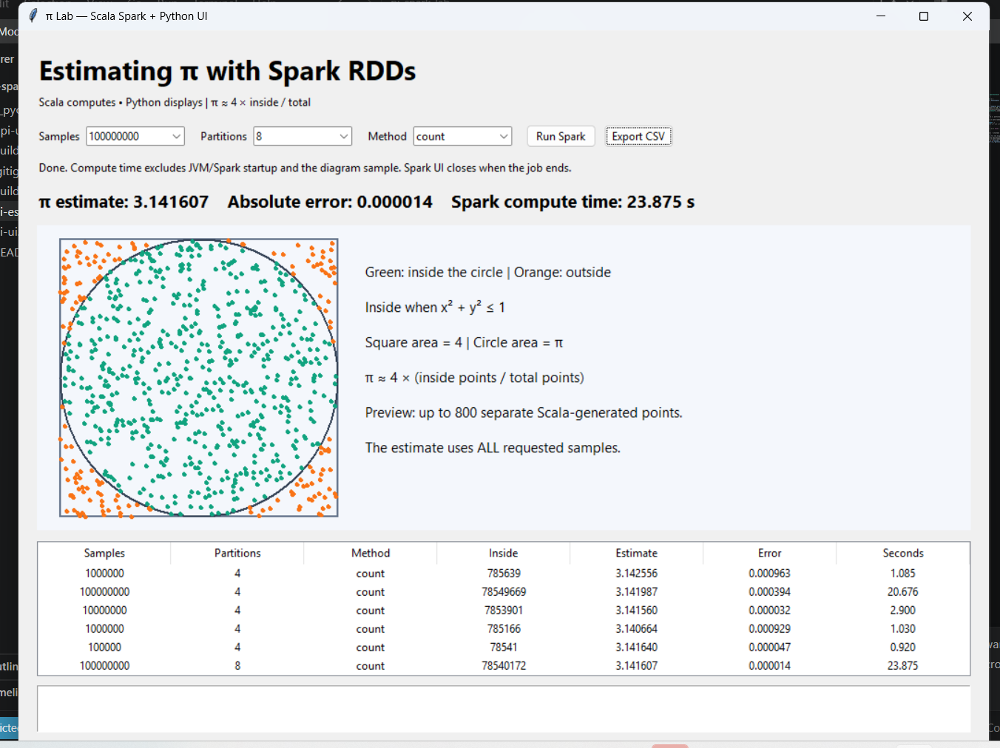

# Pi Spark Lab

Estimate **π using Monte Carlo sampling and Apache Spark RDDs**, with a Python desktop interface to configure experiments and visualize results.

The calculation runs in **Scala**. The **Python Tkinter** interface launches Spark, reads its results, and displays the estimate, absolute error, computation time, and a point diagram.

## Screenshot



In the run shown above, **100,000,000 samples** with **8 partitions** produced an estimate of **3.141607**, an absolute error of approximately **0.000014**, and a Spark computation time of **23.875 seconds**. These are results from this particular run; random sampling and hardware affect subsequent results.

## How it works

A unit circle lies inside a square with coordinates from −1 to 1 on both axes. The square has area 4, and the circle has area π.

1. Create an RDD with `sc.parallelize(1 to n, partitions)`.
2. Use `map` to generate uniformly random `(x, y)` coordinates.
3. Count points satisfying `x² + y² ≤ 1`.
4. Estimate `π ≈ 4 × inside / total`.

Two implementations are available: **filter + count**, and **map to 1 or 0 + reduce**. Transformations are lazy; the action triggers the distributed computation.

## Features

- Configurable sample count and number of partitions.
- Choice of `count` or `reduce`.
- Estimate, absolute error, and Spark computation time.
- Visualization of up to 800 separately generated preview points.
- Experiment history and CSV export.
- Background execution to keep the interface responsive.

The estimate uses all requested samples. The diagram uses a separate bounded sample. Reported computation time excludes JVM/Spark startup and preview generation.

## Requirements

- JDK 17, with `java` and `jar` available on PATH.
- Apache Spark 3.4.1, built for Scala 2.12.
- Python 3 with Tkinter.
- A configured Windows Hadoop environment where required by your Spark installation.

Add Spark's `bin` directory to PATH or provide `SPARK_HOME` when building. The build uses the Scala compiler bundled with Spark, so sbt and additional Python packages are not required.

## Build and run on Windows

Open PowerShell in the project folder:

```powershell
# Compile Scala and create the application JAR
powershell -ExecutionPolicy Bypass -File .\build.ps1

# Open the Python desktop interface
python .\pi-ui.py
```

Select the sample count, partitions, and method, then click **Run Spark**. Click **Export CSV** to save the recorded experiments.

To run the Scala program directly:

```powershell
spark-submit --master "local[*]" --class PiEstimator .\build\pi-estimator.jar 1000000 4 count
```

## Suggested experiments

| Experiment | Samples | Partitions |
| --- | --- | --- |
| Accuracy versus sample size | 1,000; 100,000; 10,000,000; 100,000,000 | 4 |
| Effect of partitioning | 10,000,000 | 1; 2; 4; 8 |
| Compare implementations | Same chosen sample count | Same chosen partition count |

More samples improve expected accuracy, although individual random runs may vary. More partitions do not always improve speed; available CPU cores and task overhead matter.

The Spark UI is usually accessible at `http://localhost:4040` while an experiment is running. It closes when the Spark process exits, and may use another port if 4040 is occupied.

## Project files

```text
pi-estimator.scala          Scala Spark RDD computation
pi-ui.py                   Python Tkinter interface
build.ps1                  Build using Spark's bundled Scala compiler
.gitignore                 Excludes generated build files and caches
README.md                  Project documentation
pi-lab-screenshot.png  Interface screenshot
```

## Publishing to GitHub

Upload the source files, this README, and the screenshot. Exclude `build/`, `__pycache__/`, and local result exports. Build the JAR locally after cloning.

